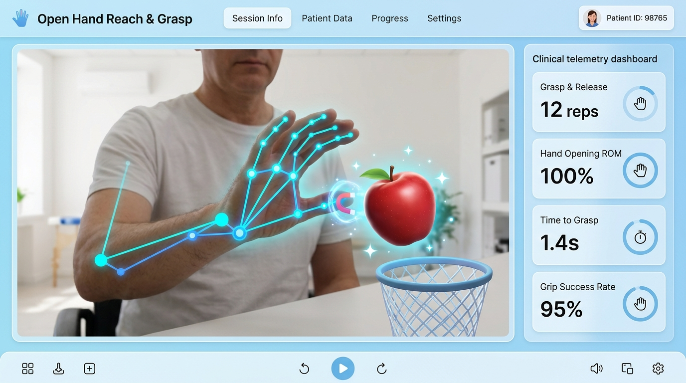

# Task 01: Open Hand Reach & Grasp (Gross Motor)

## 1. Visual Reference Mockup

## 2. Clinical Purpose & Rationale
- **Target Functional Skill**: Gross grasp and release, coordinated open-hand trajectory reaching, and active finger extension to flexion.
- **Why It Matters**: Foundational for stroke recovery and neurological rehab. Patients must relearn opening their spastic/paretic hand, reaching toward an object, closing into a secure grip, and transporting it into a container.
- **Patient Population**: Post-stroke hemiparesis, brain injury, cerebral palsy, and post-fracture hand mobility recovery.

## 3. Module Specifications & File Locations
- **Category ID**: `hand-gross-motor` (under `upper-body`)
- **Activity Slug**: `gross-grasp-and-release`
- **Component Path**: `src/modules/task1-reach-grasp/ReachGraspModule.tsx`
- **Module Manifest**: `src/modules/task1-reach-grasp/index.ts`
- **Styles Path**: `src/modules/task1-reach-grasp/reachGrasp.css`

## 4. Vision Tracking & Math Logic
- **Tracker**: `useTracker({ kind: 'hands' })`
- **Key Landmarks**:
  - Wrist: Index `0`
  - Palm Center / MCPs: Indices `5, 9, 13, 17`
  - Fingertips: Indices `4, 8, 12, 16, 20`
- **Hand Open vs. Closed Metric**:
  Average distance from wrist (0) to all 5 fingertips:
  $$\bar{D}_{\text{fingertips}} = \frac{1}{5} \sum_{i \in \{4,8,12,16,20\}} \sqrt{(x_i - x_0)^2 + (y_i - y_0)^2}$$
  - **Open Hand** (Ready to reach): $\bar{D} \ge 0.35$ (Normalized to hand bounding box)
  - **Closed Fist / Grasp** (Grabbed object): $\bar{D} < 0.20$

## 5. Gamified Gameplay Loop
1. **Target Object Spawns**: A virtual object (e.g. apple, ball, toy block) floats in a designated screen zone.
2. **Phase 1 (Open Hand Reach)**: The patient must extend their fingers wide (Open Hand $\bar{D} \ge 0.35$) and move their hand cursor over the floating object.
3. **Phase 2 (Grip & Grab)**: Once over the object, the patient closes their hand into a grasp ($\bar{D} < 0.20$). A glowing energy lock secures the object to their hand.
4. **Phase 3 (Transport & Release)**: The patient carries the grabbed object into a basket/container and opens their hand wide to drop it, triggering an emerald burst, chime sound, and `+100 PTS`.

## 6. Real-Time Telemetry Dashboard (Right Panel)
- **Grasp & Release Cycles**: Total successful pick-and-place reps (e.g. `12 reps`).
- **Hand Opening ROM**: Percentage of maximal finger extension achieved during the open phase.
- **Time to Grasp**: Duration from initial reach to successful grip (e.g. `1.4s`).
- **Grip Success Rate**: Percentage of clean grasps without premature drops (e.g. `95%`).

## 7. Deliverables Checklist
- [ ] Implement `ReachGraspModule.tsx` with floating target objects and target basket.
- [ ] Implement open-hand vs closed-fist math using MediaPipe hand landmarks.
- [ ] Add collision detection for object pickup and basket drop.
- [ ] Save grip cycles, average grasp time, and extension ROM to `localStorage`.
