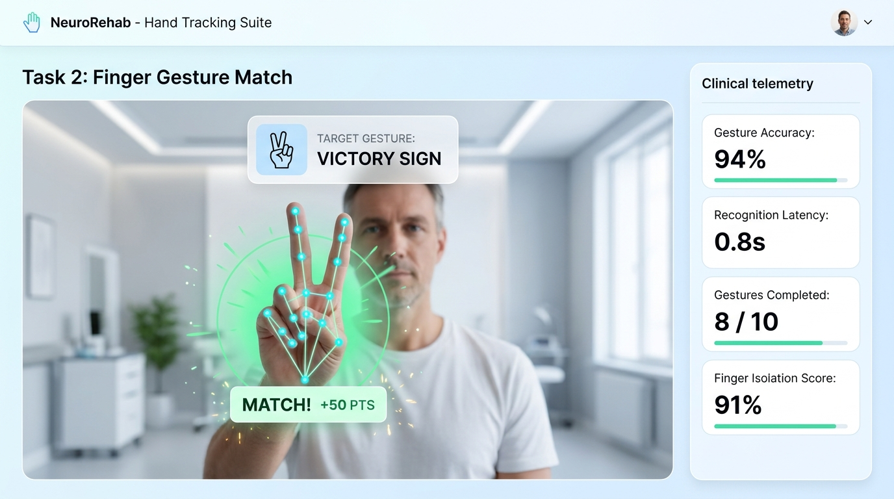

# Task 02: Finger Gesture Match (Match The Reference Pose)

## 1. Visual Reference Mockup

## 2. Clinical Purpose & Rationale
- **Target Functional Skill**: Dynamic finger isolation, motor cognition, and proprioceptive gesture replication.
- **Why It Matters**: Re-engages cortical representations of individual digits in the brain. Asking patients to switch between distinct hand configurations (thumbs up, peace sign, pointing, open palm) builds neural plasticity and breaks abnormal flexion synergy.
- **Patient Population**: Stroke survivors, traumatic brain injury patients, focal hand dystonia, and neuro-rehabilitation clinics.

## 3. Module Specifications & File Locations
- **Category ID**: `hand-fine-motor` (under `upper-body`)
- **Activity Slug**: `individual-finger-extension`
- **Component Path**: `src/modules/task2-gesture-match/GestureMatchModule.tsx`
- **Module Manifest**: `src/modules/task2-gesture-match/index.ts`
- **Styles Path**: `src/modules/task2-gesture-match/gestureMatch.css`

## 4. Vision Tracking & Math Logic
- **Tracker**: `useTracker({ kind: 'hands' })`
- **Key Landmarks**:
  - Thumb: `1, 2, 3, 4`
  - Index: `5, 6, 7, 8`
  - Middle: `9, 10, 11, 12`
  - Ring: `13, 14, 15, 16`
  - Pinky: `17, 18, 19, 20`
- **Finger Extension Detector**:
  A finger $j$ is considered **Extended** if its tip $y$-coordinate is significantly higher than its PIP joint:
  $$\text{IsExtended}(j) = y_{\text{tip}(j)} < y_{\text{pip}(j)} - 0.04$$
- **Supported Gestures**:
  - `Thumbs Up`: Thumb extended, Index/Middle/Ring/Pinky folded.
  - `Victory / Peace (2)`: Index & Middle extended, Thumb/Ring/Pinky folded.
  - `One (Pointing)`: Index extended, other 4 folded.
  - `Open Five`: All 5 fingers extended.
  - `OK Sign`: Thumb tip touches Index tip ($d < 0.04$), other 3 extended.

## 5. Gamified Gameplay Loop
1. **Reference Card**: A prominent card shows a picture/icon of the required gesture (e.g., "SHOW: VICTORY SIGN ✌️").
2. **Patient Mimicry**: Patient holds up their hand and shapes their fingers to match the card.
3. **Validation & Hold**: When the detected gesture matches the prompt, a green progress ring fills over 1.5 seconds to confirm stable hold.
4. **Reward**: Audio chime, confetti particle burst, `MATCH! +50 PTS`, and the next gesture prompt slides in.

## 6. Real-Time Telemetry Dashboard (Right Panel)
- **Gesture Accuracy**: Overall percentage score of matched poses (e.g. `94%`).
- **Recognition Latency**: Time taken from card appearance to correct gesture hold (e.g. `0.8s`).
- **Gestures Completed**: Progress counter (e.g. `8 / 10 Gestures`).
- **Finger Isolation Score**: Measures independence of active fingers vs involuntary finger folding.

## 7. Deliverables Checklist
- [ ] Implement `GestureMatchModule.tsx` with reference gesture prompt cards.
- [ ] Implement gesture recognition classification functions for Thumbs Up, Victory, Pointing, Open Five, and OK.
- [ ] Add 1.5s stable hold confirmation ring before advancing.
- [ ] Save accuracy score and latency to `localStorage`.
