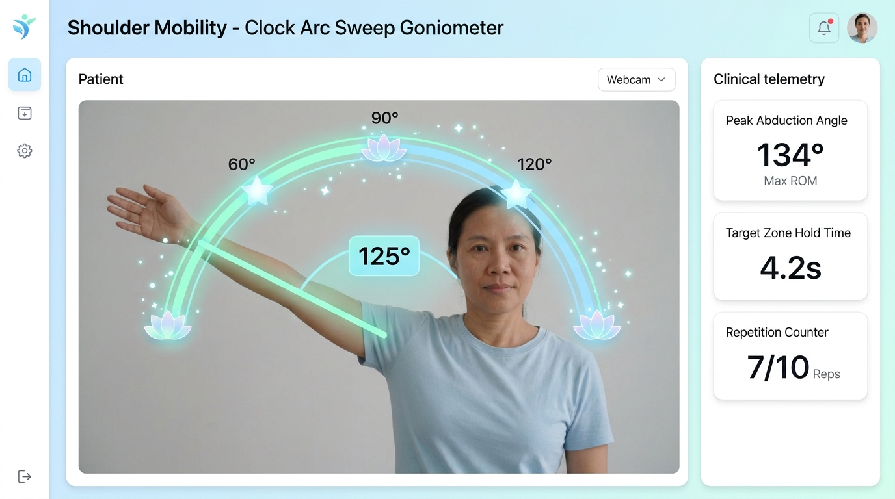

# Task 03: Shoulder Mobility – Clock Arc Sweep Goniometer

## 1. Visual Reference Mockup

## 2. Clinical Purpose & Rationale
- **Target Functional Skill**: Coronal plane shoulder abduction ($0^\circ \to 180^\circ$) and scapulohumeral rhythm.
- **Why It Matters**: Increases active shoulder mobility after rotator cuff tears, subacromial impingement, and frozen shoulder (adhesive capsulitis), enabling overhead dressing, washing, and reaching.
- **Patient Population**: Orthopedic post-surgical shoulder therapy, frozen shoulder patients, sports medicine recovery.

## 3. Module Specifications & File Locations
- **Category ID**: `shoulder-mobility` (under `upper-body`)
- **Activity Slug**: `shoulder-abduction`
- **Component Path**: `src/modules/task3-shoulder-arc/ShoulderArcModule.tsx`
- **Module Manifest**: `src/modules/task3-shoulder-arc/index.ts`
- **Styles Path**: `src/modules/task3-shoulder-arc/shoulderArc.css`

## 4. Vision Tracking & Math Logic
- **Tracker**: `useTracker({ kind: 'pose' })`
- **Key Landmarks**:
  - Hip: Left `23`, Right `24`
  - Shoulder: Left `11`, Right `12`
  - Wrist: Left `15`, Right `16`
- **Angle Calculation**:
  $$\vec{u} = \text{Hip} - \text{Shoulder}, \quad \vec{v} = \text{Wrist} - \text{Shoulder}$$
  $$\theta = \arccos\left(\frac{\vec{u} \cdot \vec{v}}{\|\vec{u}\| \|\vec{v}\|}\right) \times \frac{180}{\pi}$$

## 5. Gamified Gameplay Loop
1. **Clock Arc Gauge**: A glowing semi-circular goniometer overlay renders centered on the patient's shoulder.
2. **Checkpoint Stars**: Glowing celestial stars or lotus blossoms appear along the sweep path at $60^\circ, 90^\circ,$ and $120^\circ$.
3. **Sweeping Motion**: As the patient raises their arm out to the side, the arm line passes through checkpoints, bursting them with sparkles and chimes.
4. **Target Band Hold**: Reaching the patient's target ROM threshold initiates a 3-second hold countdown before completing the rep.

## 6. Real-Time Telemetry Dashboard (Right Panel)
- **Live Shoulder Angle**: Real-time degrees readout (e.g. `125°`).
- **Peak Abduction Angle**: Session max range of motion (e.g. `134° Max ROM`).
- **Target Zone Hold Time**: Accumulated seconds spent in the therapeutic zone ($> 90^\circ$).
- **Repetition Progress**: Set counter (e.g. `7 / 10 Reps`).

## 7. Deliverables Checklist
- [ ] Implement `ShoulderArcModule.tsx` with live canvas angle arc rendering.
- [ ] Connect MediaPipe Pose landmarks (Hip, Shoulder, Wrist) to goniometer math.
- [ ] Implement checkpoint collection logic and 3-second hold timer at peak.
- [ ] Record peak ROM and rep history to `localStorage`.

