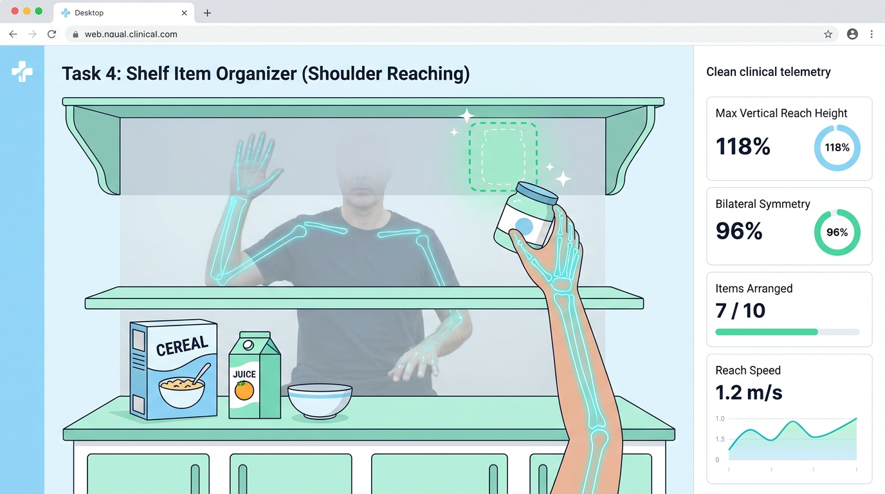

# Task 04: 2D Shelf Item Organizer (Shoulder Reaching)

## 1. Visual Reference Mockup

## 2. Clinical Purpose & Rationale
- **Target Functional Skill**: Multi-tier active arm elevation, functional shoulder flexion/abduction, and vertical reaching.
- **Why It Matters**: Relearning to organize cupboards, put away pantry goods, and retrieve items from high flat shelves using clean 2D visual target landmarks.
- **Patient Population**: Post-stroke rehabilitation, occupational therapy, rotator cuff recovery, and senior home safety training.

## 3. Module Specifications & File Locations
- **Category ID**: `shoulder-mobility` (under `upper-body`)
- **Activity Slug**: `overhead-target-reaching`
- **Component Path**: `src/modules/task4-shelf-reach/ShelfReachModule.tsx`
- **Module Manifest**: `src/modules/task4-shelf-reach/index.ts`
- **Styles Path**: `src/modules/task4-shelf-reach/shelfReach.css`

## 4. Vision Tracking & Math Logic
- **Tracker**: `useTracker({ kind: 'pose' })`
- **Key Landmarks**:
  - Shoulders: Left `11`, Right `12`
  - Elbows: Left `13`, Right `14`
  - Wrists: Left `15`, Right `16`
- **Vertical Reach Displacement**:
  $$\text{Relative Reach Height} = \frac{y_{\text{shoulder}} - y_{\text{wrist}}}{\text{Torso Length}} \times 100\%$$
  Positive values indicate reaching above shoulder height.

## 5. Gamified Gameplay Loop (2D Flat Graphic Layout)
1. **2D Flat Pantry Shelves**: 3 clean 2D shelves rendered on canvas (Bottom Counter, Middle Shelf, Top High Shelf) with semi-transparent webcam background.
2. **2D Illustrated Items**: Clean vector items (cereal box, juice carton, soup can, honey jar) sit on the bottom counter.
3. **Pickup**: Hovering the patient's wrist/hand over a 2D item picks it up.
4. **Target Slot Placement**: A dashed green target outline appears on a higher shelf. The patient physically lifts their arm to position the 2D item directly inside the dashed slot, triggering a snap alignment, pleasant audio click, and stars.

## 6. Real-Time Telemetry Dashboard (Right Panel)
- **Max Vertical Reach Height**: Percentage reach achieved above shoulder baseline (e.g. `118%`).
- **Bilateral Symmetry**: Left vs Right reaching balance (e.g. `96%`).
- **Items Arranged**: Counter (e.g. `7 / 10 Items`).
- **Reach Speed**: Velocity of vertical arm elevation (e.g. `1.2 m/s`).

## 7. Deliverables Checklist
- [ ] Implement `ShelfReachModule.tsx` with 3-tier clean 2D vector shelf graphics.
- [ ] Implement item pick-and-place logic using wrist tracking coordinates.
- [ ] Calculate real-time reach height above shoulder line.
- [ ] Persist maximum reach height and bilateral balance data in `localStorage`.
