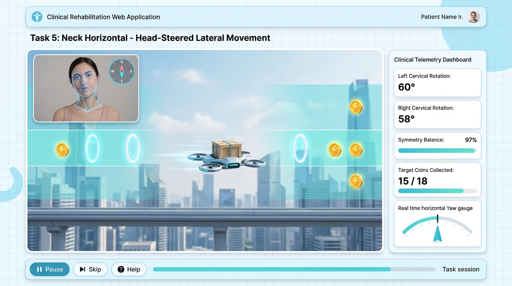

# Task 05: Neck Horizontal – Head-Steered Lateral Movement

## 1. Visual Reference Mockup

## 2. Clinical Purpose & Rationale
- **Target Functional Skill**: Active cervical transverse rotation (yaw left and right $0^\circ \to 70^\circ$).
- **Why It Matters**: Encourages full neck rotation in an intuitive, game-like horizontal steering mechanic. Eliminates neck guarding and stiffness after whiplash or sedentary posture by making head rotation directly control an on-screen object.
- **Patient Population**: Cervical rigidity, desk-worker posture rehab, vestibular gaze stabilization, whiplash recovery.

## 3. Module Specifications & File Locations
- **Category ID**: `weight-shifting-and-balance` *(or general neck template)*
- **Activity Slug**: `cervical-lateral-rotation`
- **Component Path**: `src/modules/task5-neck-horizontal/NeckHorizontalModule.tsx`
- **Module Manifest**: `src/modules/task5-neck-horizontal/index.ts`
- **Styles Path**: `src/modules/task5-neck-horizontal/neckHorizontal.css`

## 4. Vision Tracking & Math Logic
- **Tracker**: `useTracker({ kind: 'pose' })`
- **Key Landmarks**:
  - Nose: Index `0`
  - Left Ear: Index `7`, Right Ear: Index `8`
  - Left Shoulder: Index `11`, Right Shoulder: Index `12`
- **Head Yaw (Rotation) Ratio**:
  $$R_{\text{yaw}} = \frac{x_{\text{nose}} - x_{\text{left\_ear}}}{x_{\text{right\_ear}} - x_{\text{left\_ear}}}$$
- **Horizontal Object Coordinate Mapping**:
  $$X_{\text{object}} = \text{Clamp}\left(0.1, 0.9, 0.5 + (R_{\text{yaw}} - 0.5) \times 1.8\right)$$
  - Turning head left moves the on-screen object left.
  - Turning head right moves the on-screen object right.

## 5. Gamified Gameplay Loop
1. **Interactive Slider / Drone**: A friendly floating character or drone hovers horizontally along the screen.
2. **Horizontal Head Steering**: Turning head smoothly to the left steers the drone to the left; turning right steers it to the right.
3. **Collect Targets**: Floating rings or glowing coins appear on the left and right sides of the screen.
4. **Target Capture**: Moving the character onto coins collects them with a sparkling pop and sound effect.

## 6. Real-Time Telemetry Dashboard (Right Panel)
- **Left Cervical Rotation**: Max degrees turned left (e.g. `60° Left`).
- **Right Cervical Rotation**: Max degrees turned right (e.g. `58° Right`).
- **Symmetry Balance**: Ratio of left vs right rotation equality (e.g. `97%`).
- **Target Coins Collected**: Score (e.g. `15 / 18 Coins`).

## 7. Deliverables Checklist
- [ ] Implement `NeckHorizontalModule.tsx` with horizontal canvas lane and movable character.
- [ ] Connect Nose and Ear landmarks to map head yaw to character horizontal position $X$.
- [ ] Add left and right collectible targets and collision audio.
- [ ] Store bilateral cervical rotation degrees in `localStorage`.
