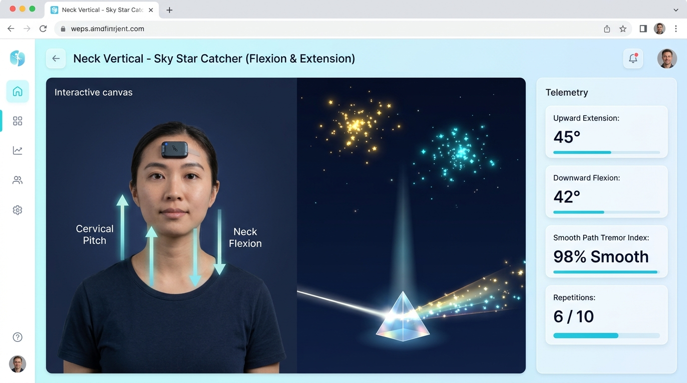

# Task 06: Neck Vertical – Up & Down Character Star Catcher

## 1. Visual Reference Mockup

## 2. Clinical Purpose & Rationale
- **Target Functional Skill**: Cervical sagittal plane flexion (chin down) and extension (head tilted up).
- **Why It Matters**: Counteracts forward head posture ("tech-neck") and restores vertical gaze navigation. Turning head pitch into an intuitive vertical flight control helps patients regain confidence looking up and down without dizziness.
- **Patient Population**: Postural fatigue, chronic neck stiffness, vestibular visual-vestibular interaction training, elderly gaze stability.

## 3. Module Specifications & File Locations
- **Category ID**: `weight-shifting-and-balance` *(or general neck template)*
- **Activity Slug**: `cervical-flexion-extension`
- **Component Path**: `src/modules/task6-neck-vertical/NeckVerticalModule.tsx`
- **Module Manifest**: `src/modules/task6-neck-vertical/index.ts`
- **Styles Path**: `src/modules/task6-neck-vertical/neckVertical.css`

## 4. Vision Tracking & Math Logic
- **Tracker**: `useTracker({ kind: 'pose' })`
- **Key Landmarks**:
  - Nose: Index `0`
  - Midpoint of Ears: $\frac{L_7 + R_8}{2}$
- **Pitch Angle & Vertical Coordinate Mapping**:
  $$\Delta y = y_{\text{nose}} - y_{\text{ear\_mid}}$$
  $$Y_{\text{character}} = \text{Clamp}\left(0.1, 0.9, 0.5 + (\Delta y \times 3.0)\right)$$
  - Tilting head UP ($\Delta y < 0$) lifts the character into the upper sky.
  - Dipping head DOWN ($\Delta y > 0$) lowers the character into the lower ground zone.

## 5. Gamified Gameplay Loop
1. **Vertical Flying Character**: A charming flying bird, astronaut, or balloon floats in the center column of the screen.
2. **Head Up (Fly High)**: Tilting head up flies the character into the clouds to touch sparkling gold stars.
3. **Head Down (Dive Low)**: Dipping chin downward dives the character to collect glowing pearls or crystals along the lower lane.
4. **Star Burst**: Touching each star triggers a chime, visual starburst, and awards `+50 PTS`.

## 6. Real-Time Telemetry Dashboard (Right Panel)
- **Upward Extension Angle**: Peak angle achieved looking up (e.g. `45° Extension`).
- **Downward Flexion Angle**: Peak angle achieved looking down (e.g. `40° Flexion`).
- **Star Catch Accuracy**: Percentage of target stars collected (e.g. `96%`).
- **Smooth Tracking Index**: Movement path smoothness score (e.g. `98% Smooth`).

## 7. Deliverables Checklist
- [ ] Implement `NeckVerticalModule.tsx` with vertical flight lane and animated flying character.
- [ ] Map head tilt $\Delta y$ to smooth character elevation on canvas.
- [ ] Add star spawning in high and low altitude bands.
- [ ] Persist vertical ROM degrees and catch accuracy to `localStorage`.
