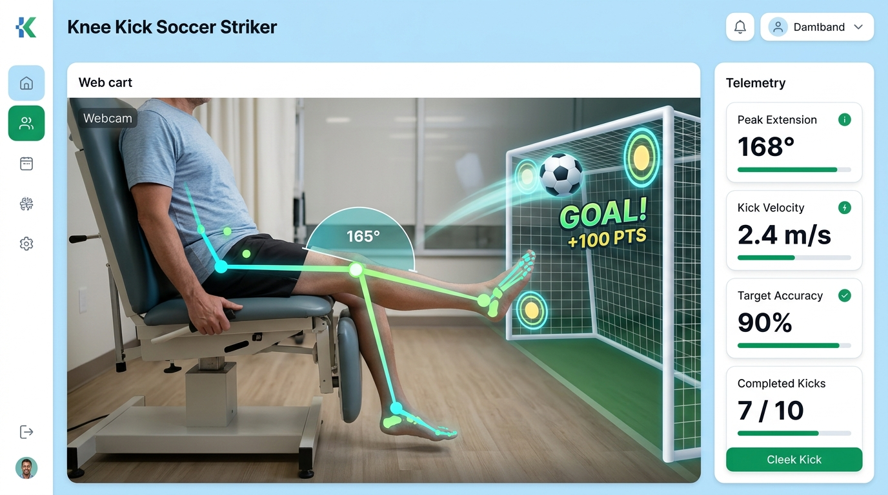

# Task 07: 2D Leg Kick Soccer Game (Knee Extension)

## 1. Visual Reference Mockup

## 2. Clinical Purpose & Rationale
- **Target Functional Skill**: Seated quadriceps strengthening, active knee terminal extension ($90^\circ \to 180^\circ$), and leg motor initiation.
- **Why It Matters**: Knee terminal extension is crucial for stable walking and standing up from chairs. Using a friendly 2D arcade soccer game motivates patients to extend their knees fully without intimidation.
- **Patient Population**: Total knee replacement, ACL rehabilitation, quadriceps weakness, geriatric mobility therapy.

## 3. Module Specifications & File Locations
- **Category ID**: `knee-mobility-and-control` (under `lower-body`)
- **Activity Slug**: `seated-knee-extension`
- **Component Path**: `src/modules/task7-knee-soccer/KneeSoccerModule.tsx`
- **Module Manifest**: `src/modules/task7-knee-soccer/index.ts`
- **Styles Path**: `src/modules/task7-knee-soccer/kneeSoccer.css`

## 4. Vision Tracking & Math Logic
- **Tracker**: `useTracker({ kind: 'pose' })`
- **Key Landmarks**:
  - Hips: Left `23`, Right `24`
  - Knees: Left `25`, Right `26`
  - Ankles: Left `27`, Right `28`
  - Foot Index / Toes: Left `31`, Right `32`
- **Knee Angle Calculation**:
  $$\theta_{\text{knee}} = \arccos\left(\frac{\vec{V}_{\text{hip-knee}} \cdot \vec{V}_{\text{ankle-knee}}}{|\vec{V}_{\text{hip-knee}}| |\vec{V}_{\text{ankle-knee}}|}\right) \times \frac{180}{\pi}$$
  - Full Extension Target: $\theta_{\text{knee}} \ge 160^\circ$

## 5. Gamified Gameplay Loop (Clean 2D Flat Arcade Art)
1. **2D Soccer Pitch**: A clean 2D vector soccer net with target bullseyes in the top-left, top-right, and bottom corners.
2. **Kick Initiation**: Patient sits with knee flexed at $90^\circ$. A 2D soccer ball waits at their virtual foot.
3. **Leg Extension Kick**: Kicking the leg forward into extension launches the 2D ball with animated motion lines towards the active target corner.
4. **Goal Celebration**: Hitting the corner target triggers stadium audio, confetti burst, and an energetic `GOAL! 100 PTS` banner.

## 6. Real-Time Telemetry Dashboard (Right Panel)
- **Live Knee Angle**: Current angle reading with goniometer bar (e.g. `165°`).
- **Kick Speed**: Foot acceleration velocity (e.g. `2.1 m/s`).
- **Target Accuracy**: Percentage of accurate shots on target (e.g. `92%`).
- **Kicks Completed**: Set progress (e.g. `8 / 10 Kicks`).

## 7. Deliverables Checklist
- [ ] Implement `KneeSoccerModule.tsx` with clean 2D vector soccer pitch and animated ball physics.
- [ ] Compute real-time knee extension angle and foot velocity.
- [ ] Add corner target hit detection and celebratory goal audio/banners.
- [ ] Store peak ROM degrees and kick velocity in `localStorage`.
