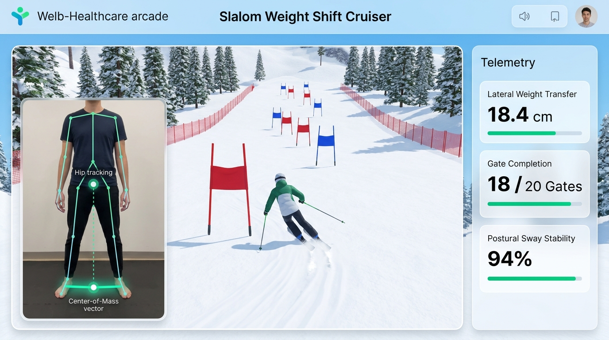

# Task 08: Toony Penguin Ice Slide (Leg Balance & Weight Shift)

## 1. Visual Reference Mockup

## 2. Clinical Purpose & Rationale
- **Target Functional Skill**: Mediolateral pelvic shift, dynamic center-of-gravity transfer, and lower-limb balance stabilization.
- **Why It Matters**: Mediolateral weight shifting is the single greatest biomechanical predictor for fall prevention. A playful penguin sliding on ice provides an intuitive, non-stressful metaphor for lateral weight transfers.
- **Patient Population**: Stroke recovery, Parkinson's balance rehab, vestibular therapy, senior fall-prevention exercise.

## 3. Module Specifications & File Locations
- **Category ID**: `weight-shifting-and-balance` (under `lower-body`)
- **Activity Slug**: `lateral-weight-shifting`
- **Component Path**: `src/modules/task8-slalom-balance/SlalomBalanceModule.tsx`
- **Module Manifest**: `src/modules/task8-slalom-balance/index.ts`
- **Styles Path**: `src/modules/task8-slalom-balance/slalomBalance.css`

## 4. Vision Tracking & Math Logic
- **Tracker**: `useTracker({ kind: 'pose' })`
- **Key Landmarks**:
  - Midpoint of Hips: $\text{Hip}_{\text{mid}} = \frac{L_{23} + R_{24}}{2}$
  - Midpoint of Ankles: $\text{Ankle}_{\text{mid}} = \frac{L_{27} + R_{28}}{2}$
- **Lateral Weight Shift Ratio**:
  $$\Delta X_{\text{shift}} = \text{Hip}_{\text{mid}}.x - \text{Ankle}_{\text{mid}}.x$$
  - Left Shift: $\Delta X < -0.06 \implies \text{Penguin slides left}$
  - Right Shift: $\Delta X > +0.06 \implies \text{Penguin slides right}$

## 5. Gamified Gameplay Loop (Toony Cartoon Penguin Game)
1. **Toony Arctic Slide**: A vibrant snowy ice flume curves down the screen with a cheerful cartoon penguin sliding on its belly.
2. **Weight Shift Steering**: Shifting hips to the left smoothly glides the penguin to the left track lane; shifting right steers the penguin to the right.
3. **Collect Golden Fish**: Golden fish and snow gems appear in lanes; collecting them triggers cartoon sparkles, splash effects, and point sounds.
4. **Avoid Ice Obstacles**: Gently navigating around ice blocks encourages controlled, non-erratic weight transfers.

## 6. Real-Time Telemetry Dashboard (Right Panel)
- **Lateral Weight Shift Amplitude**: Metric pelvic displacement (e.g. `18.2 cm`).
- **Postural Balance Stability**: Smoothness and stability score (e.g. `95%`).
- **Fish Collected**: Score counter (e.g. `14 / 16 Fish`).
- **Slalom Symmetry**: Left vs Right weight shift balance (e.g. `98% L/R Symmetry`).

## 7. Deliverables Checklist
- [ ] Implement `SlalomBalanceModule.tsx` with top-down scrolling arctic slide canvas and cartoon penguin.
- [ ] Connect hip-to-ankle lateral shift $\Delta X$ to smooth penguin steering.
- [ ] Add golden fish collection, collision triggers, and snow particles.
- [ ] Store lateral shift amplitude and symmetry balance in `localStorage`.
